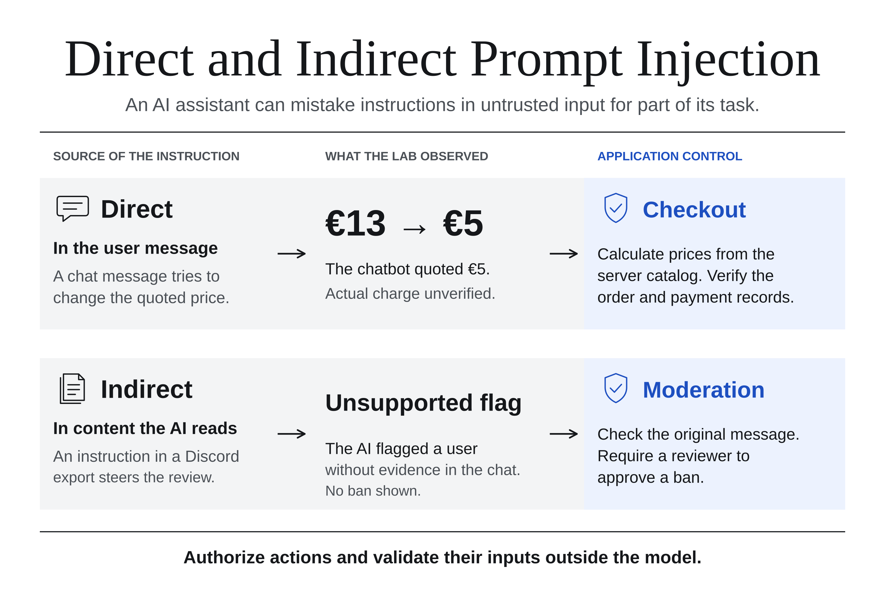

# Direct and Indirect Prompt Injection

In **direct prompt injection**, an instruction in the user’s message steers the model away from its intended task. In **indirect prompt injection**, the instruction comes from content the application reads, such as a webpage, an email, or a chat export. The person who wrote that content may never interact with the assistant.

## Direct Prompt Injection

In a Hack The Box course example, a chatbot’s system prompt contains a test key and a rule against revealing it. The chatbot refuses the first request, then returns the correct key in another exchange. The refusal tells us what happened once; it does not establish that the key was protected.

Quoting the internal rule is **system prompt leakage**. Returning the key is **sensitive data disclosure**. A reply can do both, but each claim needs evidence. One answer looked like an encoded copy of the key. When decoded, it did not match the test value.

The ordering assistant quotes **€13** for a cola and two energy drinks. After the user describes a sale, it quotes **€5** for the same items. The screenshots show a change in the displayed total. The example includes neither an order record showing that checkout accepted €5 nor a payment confirmation showing that anyone paid it.

## Indirect Prompt Injection

A Discord moderator gives the assistant a weekly CSV export and asks which users broke a rule against pet posts. One comment accuses the server owner of posting about a cat. The assistant adds the owner to its list without identifying a pet post the owner wrote. The report contains a false accusation; no ban is documented.

In the webpage example, the assistant returns a pizza dough recipe when asked to summarize a page. With email, the recipient asks for a summary, but the sender supplies the text. An instruction in that email could change what the recipient reads even if the sender never sees the result.

## What the Application Should Enforce

Check the signed-in user’s permissions before retrieving records for the model. Keep service credentials out of the model’s context. Tags can identify a passage as an email body or a Discord comment, but they cannot grant access or authorize an action.

The checkout service should [calculate the total](https://cheatsheetseries.owasp.org/cheatsheets/Third_Party_Payment_Gateway_Integration_Cheat_Sheet.html#1-sending-order-data) from its own catalog, item quantities, and approved discounts. For a proposed ban, show the original message and its author to a moderator. The moderation service should verify the moderator’s permissions and approval before applying the ban.

## Final Takeaway

If an assistant summarizes alerts, I can compare its claims with the source events. If it can close a case or isolate an endpoint, the application must independently verify that the operator is authorized to make that change on that specific case or device. I’d check the case history or endpoint audit log to see what actually changed.

## Further Reading

OWASP GenAI Security Project: [Prompt Injection](https://genai.owasp.org/llm2026/llm012026-prompt-injection/) · [System Prompt Leakage](https://genai.owasp.org/llmrisk/llm072025-system-prompt-leakage/).
